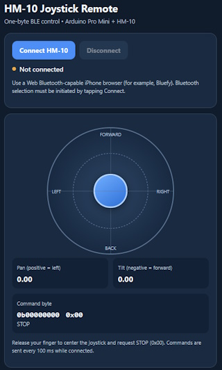

# HM-10 Joystick Remote for iPhone

This is a single-page touch joystick remote to control via BlueTooth a simple robot, which uses **HM-10 BLE Module + Arduino Pro Mini**. 
This remote is intended to be run on an **iPhone** device.
I use it as a remote controller in a lab for one of my courses: https://dejazzer.com/eece3015/index.html 

The remote's role is to generate periodically a one byte (8 bits) control based on the joystick's position:
| Direction | Bit | Value |
|---|---:|---:|
| Left (pan > 0) | 0 | `0x01` |
| Right (pan < 0) | 1 | `0x02` |
| Forward (tilt < 0) | 2 | `0x04` |
| Backward (tilt > 0) | 3 | `0x08` |
| Center | — | `0x00` |

Diagonal movement combines bits: forward-left = `0x05`, forward-right = `0x06`, backward-left = `0x09`, backward-right = `0x0A`. Bits 4–7 are always zero. The joystick uses a **20% dead zone**, adjustable on the page.

## How to use on iPhone

1. Install **Bluefy – Web BLE Browser** from the iOS App Store.
2. Enable Bluetooth on the iPhone. 
3. Open **Bluefy**, enter this HTTPS GitHub Pages URL to load the joystick webpage:
   https://eigenpi.github.io/HM-10-Joystick-Remote-for-iPhone/index.html 

## Credits

This was developed with help from AI Tools.
